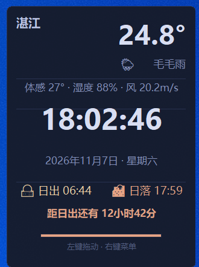

# 桌面天气小组件 · Desktop Weather Widget

常驻 Windows 桌面右上角的轻量小组件：**实时时钟 · 天气 · 日出日落**。

纯 Python 标准库（tkinter）实现，无第三方依赖；天气与日出日落数据来自 [Open-Meteo](https://open-meteo.com/) 免费开放接口，**无需注册、无需 API Key**。



## ✨ 功能

- 🕐 实时时钟（秒级刷新）+ 日期星期
- 🌤️ 当前天气：温度、天气状况、体感温度、湿度、风速（默认每 10 分钟自动刷新）
- 🌅 当日日出/日落时间、距离下一节点的倒计时、日照进度条
- 🖱️ 左键拖动移动，位置自动记忆（重启后仍在原位）
- 🙈 右下角「隐藏」按钮；隐藏后屏幕右上角出现「👁 显示」小按钮，点击恢复
- 🎮 全屏自动隐藏：检测到全屏游戏 / 全屏视频时自动隐藏，退出全屏自动恢复
- 🔌 右键菜单一键开关「开机自启动」（直接启用/禁用 Windows 计划任务，无需管理员权限）
- 🎛️ 本机控制通道：TCP `127.0.0.1:39217` 可发送命令控制小组件
- 📐 窗口尺寸按字体实测自动计算，任意系统缩放比例（100%/125%/150%）下都不重叠

## 🚀 快速开始（Windows 10/11）

1. 安装 Python 3.8+（tkinter 为内置模块，无需额外安装）
2. 下载本仓库，将 `config.example.json` 复制为 `config.json`，把 `city`/`lat`/`lon` 改成你的城市
3. 双击 `desktop-widget.vbs` 静默启动（无窗口）
   - 需要看报错时用 `desktop-widget.bat`（带控制台）
4. 右键小组件 → 勾选「开机自启动」，以后登录 Windows 自动运行

> 城市经纬度可以到 [open-meteo.com 地理编码](https://geocoding-api.open-meteo.com/v1/search?name=Zhanjiang&count=5&format=json&language=zh) 查询，或直接搜索「城市名 经纬度」。

## 🖱️ 使用说明

| 操作 | 效果 |
|------|------|
| 左键拖动 | 移动位置（自动记忆） |
| 右键 → 刷新天气 | 立即刷新天气数据 |
| 右键 → 隐藏小组件 | 手动隐藏，右上角出现恢复小按钮 |
| 右键 → 开机自启动 | 勾选=登录自动启动；取消=关闭 |
| 右键 → 退出小组件 | 完全退出，双击快捷方式或 vbs 重新打开 |
| 右下角 🙈 隐藏按钮 | 与右键「隐藏小组件」相同 |
| 全屏游戏/视频 | 自动隐藏，退出全屏自动恢复 |

## ⚙️ 配置（config.json）

首次运行会自动生成。字段说明：

| 字段 | 说明 | 默认 |
|------|------|------|
| `city` | 城市名（仅显示） | 湛江 |
| `lat` / `lon` | 纬度 / 经度（天气与日出日落按此计算） | 21.23 / 110.39 |
| `alpha` | 窗口不透明度 0~1 | 0.93 |
| `margin_x` / `margin_y` | 默认距屏幕右上角的边距（像素） | 16 |
| `refresh_minutes` | 天气刷新间隔（分钟） | 10 |
| `topmost` | 是否置顶显示 | true |
| `position` | 记住的窗口位置 `[x, y]`，`null` 表示用默认边距 | null |

## 🎛️ 控制通道

小组件在本机监听 `127.0.0.1:39217`（同时用作单实例锁），连接后发送一行命令即可控制：

| 命令 | 作用 |
|------|------|
| `hide` | 隐藏小组件（显示恢复按钮） |
| `show` | 显示小组件 |
| `quit` | 完全退出 |
| `autostart` | 切换开机自启动开关 |
| `state` | 返回内部状态（manual/auto/hold/autostart） |

示例（用任意 TCP 客户端，如 Python）：

```python
import socket
s = socket.socket(); s.connect(("127.0.0.1", 39217))
s.sendall(b"hide\n"); s.close()
```

## 📁 项目结构

```
desktop-widget/
├── widget.py               # 主程序（Python 标准库 + tkinter）
├── desktop-widget.vbs      # 静默启动器（自动查找 Python）
├── desktop-widget.bat      # 调试启动器（带控制台）
├── uninstall-autostart.bat # 移除开机自启计划任务
├── config.example.json     # 配置示例（复制为 config.json 使用）
├── weather2.ico            # 图标（可用于桌面快捷方式）
├── preview.png             # 小组件截图
└── LICENSE                 # MIT
```

## 📡 数据来源

天气与日出日落数据来自 [Open-Meteo](https://open-meteo.com/)（`api.open-meteo.com`），免费开放接口，请遵守其[使用条款](https://open-meteo.com/en/terms)。

## 📄 License

[MIT](LICENSE)
